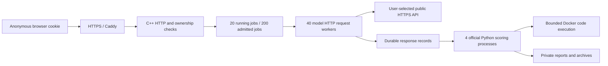

# C++ service and anonymous workspaces

The production service is Linux C++20. `server/` owns browser HTTP, signed sessions, ownership checks, admission control, job scheduling and libcurl model HTTP/SSE requests. Python remains the official grading and archive boundary (`llm_eval/native_bridge.py`), including real Docker execution of Python code benchmarks. The cross-platform CLI remains available. The earlier Python web implementation is retained as a regression and performance baseline; the `llm-eval-web` command launches C++.

## Identity and isolation

- A random 128-bit owner ID is stored in a server-signed, HttpOnly, SameSite=Strict cookie. HTTPS adds Secure. The guest cookie lasts 30 days and renews on entry. There is no registration or account recovery.
- IP is used for throttling only. Different browser profiles behind the same IP have separate workspaces. Tabs within one profile share the cookie. Clearing it or changing browsers loses access to the previous anonymous workspace.
- Every list, detail, cancellation, report and ZIP operation checks the signed owner against the job owner. Knowing another task ID does not grant access. Administrators see their own jobs, including pre-migration administrator history.
- Guests supply their own model key. Only administrators can use the configured default key, and only with its configured endpoint. Keys remain in the native process memory, never in scorer environments or job configuration files.
- Guest endpoints require HTTPS and public IP addresses. The service validates all DNS results, pins them for the transfer, validates TLS, and disables redirects and inherited proxies. Private, reserved and loopback addresses are rejected.

## Resource limits and recovery

Default limits are 20 running jobs, 40 in-flight model requests, four scoring processes, 200 admitted running/queued jobs, and two admitted jobs per owner. A job may request up to 10 workers. This provides data and action isolation; CPU, network and queue capacity remain shared. It does not promise 100 simultaneous CPU-heavy evaluations with no waiting.

The C++ HTTP backend closes each internal response connection so idle Caddy connections cannot occupy all 32 HTTP threads. Caddy still manages browser HTTPS connections. Completed detail responses are cached with ETags; history polling runs every 10 seconds during active work and idle refreshes slow to 15 seconds.

Model responses are saved before scoring. A failed scorer cannot silently remove recorded attempts or usage. Finalization recovers ungraded response records without issuing another model request. API tests allow one attempt per case; benchmark retries preserve every attempt. Scheduler waiting time is separate from measured API latency. Missing usage or an unmeasurable body generation window leaves TPS unavailable.

Shutdown cancels queued and running work. Restart marks unfinished jobs interrupted and recovers saved accounting. Docker containers are labelled by service, scorer and job; stale containers are cleaned within that ownership scope. API tests cannot resume across time periods. Both test modes support offline grading with the existing CLI.

## Verification

CI builds the Release C++ binary with active test assertions, tests fragmented SSE and incomplete usage, and exercises the real HTTP service. Coverage includes anonymous ownership, cookie tampering, cross-origin rejection, credential-free scorer environments, cancellation, request/scorer limits, 100 simultaneous connections, exactly 30 attempts despite rate limits and stream interruptions, full Quick40 Docker grading and offline rescoring. LiveCodeBench private assets are tested separately on the deployment server because those assets are not committed.

Use [deployment instructions](deployment.md) for building, systemd, HTTPS and capacity configuration. See the dated performance/validation report for measured results and limits; language choice alone does not determine public network performance.
